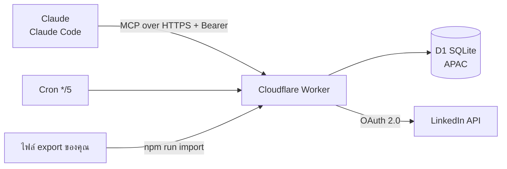

# LinkedIn MCP

> เซิร์ฟเวอร์ MCP ที่ให้ Claude จัดการ LinkedIn ของคุณได้ทั้งเครือข่ายอาชีพ การหางาน และการโพสต์
> ทุกการเผยแพร่ต้องผ่านการยืนยันจากคุณก่อนเสมอ


---

## ทำอะไรได้บ้าง

| โมดูล | ทำอะไร |
|---|---|
| **Network CRM** | นำเข้า connections จากไฟล์ export, ติด tag, จดบันทึก, ตั้งเตือนทักกลับ, ร่างข้อความทัก |
| **Warm intro** | หาคนที่รู้จักในบริษัทของงานที่สนใจ เพื่อขอ referral |
| **Job engine** | เก็บเป้าหมายและ resume, นำเข้างาน (ตัดซ้ำอัตโนมัติ), ให้คะแนนความตรง, ติดตามการสมัคร |
| **Posting** | ร่างโพสต์ → แนบรูป (ไม่เกิน 1 MB) → ตัวอย่าง → ยืนยันด้วยรหัส 6 หลัก → เผยแพร่ หรือตั้งเวลาไว้ |
| **Scheduler** | Cron ตรวจคิวทุก 5 นาที โพสต์เมื่อถึงเวลาที่ยืนยันไว้ |
| **Audit log** | บันทึกทุกการเรียก tool ไว้ตรวจย้อนหลัง |

## สถาปัตยกรรม



- **Worker** รัน MCP แบบ stateless และตรวจ token ทุก request
- **D1** เก็บ CRM, งาน, โพสต์, คิว, token ที่เข้ารหัสแล้ว และ audit log
- **Cron** โพสต์งานที่ถึงเวลา โดยการยืนยันทำไว้แล้วตอนตั้งเวลา

## สถานะ

| ส่วน | สถานะ |
|---|---|
| CRM, งาน, นำเข้าไฟล์ export | ✅ ใช้งานได้ |
| Warm intro, invitations | ✅ ใช้งานได้ (ทดสอบกับข้อมูลตัวอย่าง) |
| OAuth และโพสต์ | 🟡 เชื่อมต่อได้แล้ว รอผลิตภัณฑ์ที่ขอสิทธิ์ให้ครบ |
| ตั้งเวลาโพสต์ | 🟡 โค้ดพร้อม ยังไม่ได้ทดสอบการโพสต์จริง |
| Company Page | ⏳ ยังไม่เริ่ม (ต้องเป็น LinkedIn Partner) |

## หลักการออกแบบ

- **ไม่ส่งข้อความหรือโพสต์เอง** ทุกการเผยแพร่ต้องมีรหัสยืนยันจากผู้ใช้ และรหัสใช้ได้ครั้งเดียว
- **ไม่ดึงข้อมูลจาก LinkedIn โดยไม่ได้รับอนุญาต** ใช้ไฟล์ export ที่ผู้ใช้ขอเองเท่านั้น
- **Token ไม่อยู่ในโค้ด** Access token เข้ารหัส AES-GCM ก่อนเก็บในฐานข้อมูล คีย์มาจาก secret ของ Worker
- **ข้อมูลส่วนตัวน้อยที่สุด** ไม่เก็บเบอร์โทรหรืออีเมลจาก resume
- **ทุกการเรียกถูกบันทึก** ตรวจย้อนหลังได้ใน `audit_log`

## เริ่มต้นใช้งาน

```bash
npm install
cp .env.example .env          # ใส่ MCP_TOKEN
npx wrangler d1 create linkedin-mcp   # แล้วแก้ database_id ใน wrangler.toml
npx wrangler secret put MCP_TOKEN
npx wrangler deploy
```

เชื่อมกับ Claude Code:
```bash
claude mcp add --transport http --scope user linkedin-mcp <URL>/mcp \
  --header "Authorization: Bearer <MCP_TOKEN>"
```

นำเข้าไฟล์ export จาก LinkedIn (Settings → Data privacy → Get a copy of your data):
```bash
npm run import -- connections  "path/to/Connections.csv"
npm run import -- invitations  "path/to/Invitations.csv"
npm run import -- profile      "path/to/Profile.csv"
```

การนำเข้าซ้ำปลอดภัย ระบบไม่สร้างแถวซ้ำ และบันทึกการเปลี่ยนบริษัทหรือตำแหน่งเป็นบันทึกอัตโนมัติ

## Tools

| กลุ่ม | Tools |
|---|---|
| เครือข่าย | `search_connections` `get_contact` `tag_contact` `add_note` `set_followup` `due_followups` `complete_followup` `draft_outreach` `find_warm_intro` `list_invitations` |
| งาน | `set_targets` `get_targets` `ingest_jobs` `list_jobs` `save_matches` `track_application` `list_applications` `skill_gap` |
| โพสต์ | `linkedin_connect` `linkedin_status` `draft_post` `request_publish` `confirm_publish` `list_posts` `list_scheduled` `cancel_scheduled` |
| ระบบ | `ping` |

## โครงสร้างโค้ด

```
src/
  worker.ts     HTTP routes, ตรวจ token, ลงทะเบียน tools และ Cron handler
  db.ts         ชนิดข้อมูล D1, audit log, batch, เวลาไทย
  csv.ts        อ่าน Connections.csv
  imports.ts    อ่าน Invitations.csv และ Profile.csv
  crm.ts        tools ของ connections
  intro.ts      จับคู่บริษัทสำหรับ warm intro
  jobs.ts       tools ของงาน
  linkedin.ts   OAuth, เข้ารหัส token, โพสต์ และยืนยัน
  schedule.ts   คิวโพสต์และ Cron
scripts/
  import-linkedin.mjs   ส่งไฟล์ export จากเครื่องไปยัง Worker
```

## แผนถัดไป
- ทดสอบการโพสต์ตามเวลาจริงหลังได้รับอนุมัติผลิตภัณฑ์ *Share on LinkedIn*
- เพิ่ม OAuth ให้ claude.ai ใช้ connector ได้โดยตรง
- เพิ่มผู้ใช้หลายคนพร้อมการแยกข้อมูลตามผู้ใช้

---

ใช้เพื่อการจัดการ LinkedIn ของตัวเองเท่านั้น โปรเจกต์นี้ไม่เกี่ยวข้องกับ LinkedIn Corporation
